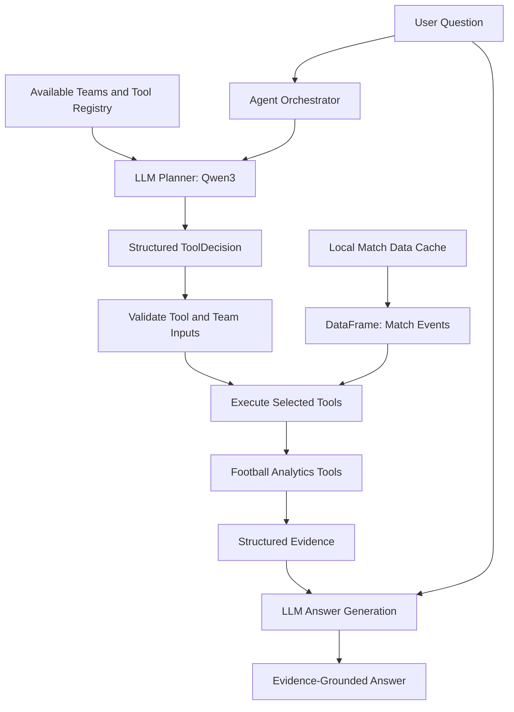

# Temperance Football Analytics AI Agent

An evidence-grounded football analytics agent that combines structured match event data, deterministic Python analysis, and a local large language model to answer football questions in natural language.

The agent selects analytical tools based on the user's question, executes them against StatsBomb event data, and generates an answer grounded in the resulting statistics.

## Overview

Traditional football statistics scripts require users to know which metric to calculate and how to interpret the result. This project explores how an LLM-powered agent can make football analytics more accessible while keeping numerical calculations deterministic and verifiable.

**Core design principle:** Let Python calculate the statistics; let the LLM plan the analysis and explain the evidence.

### Key Features

- **Natural-language queries:** Ask questions about attacking performance and ball progression.
- **Dynamic tool selection:** The LLM selects relevant analytical tools based on the question.
- **Deterministic analytics:** Python and pandas calculate football metrics instead of relying on the LLM to perform numerical calculations.
- **Structured decisions:** Pydantic validates the planner's structured output.
- **Evidence-grounded responses:** The LLM interprets computed statistics and is instructed not to invent unsupported match-specific explanations.
- **Local model inference:** Ollama runs Qwen3:4b locally, avoiding dependence on a paid OpenAI API for the main workflow.
- **Local data caching:** Match events are saved locally to reduce repeated network requests.
- **Automated tests:** 19 tests cover analytical edge cases and tool execution.

## Architecture



### Main Components

| Component               | Responsibility                                                        |
| ----------------------- | --------------------------------------------------------------------- |
| `src/agent.py`          | Tool selection, execution orchestration, and answer generation        |
| `src/analysis_tools.py` | Deterministic football statistics and input validation                |
| `src/tool_registry.py`  | Tool descriptions and selection guidance                              |
| `src/data_loader.py`    | Loading match events from local cache or downloading and caching them |
| `test_agent.py`         | Runnable end-to-end demonstration                                     |
| `tests/`                | Automated tests for analytics and agent execution                     |
| `data/`                 | Cached match event data                                               |
| `notebooks/`            | Exploratory analysis and development notebooks                        |
| `docs/`                 | Demo examples and project documentation                               |

## Analytical Tools

The agent currently supports four analytical tools.

| Tool                  | What it measures                                                                                     |
| --------------------- | ---------------------------------------------------------------------------------------------------- |
| `shot_analysis`       | Shot count, total expected goals (xG), and average xG per shot                                       |
| `final_third_entries` | Successful passes entering the attacking final third                                                 |
| `progressive_passes`  | Successful passes that move the ball closer to the opponent's goal by a specified distance threshold |
| `team_summary`        | A combined summary of shooting, passing, and ball-progression metrics                                |

The LLM chooses which tool or tools to execute. The underlying statistics are calculated by Python.

## Example Demonstrations

The following results come from the current cached match dataset.

### Demo 1 — Shot Quality vs. Shot Volume

**Question**

> Why did Arsenal create fewer shots but still produce higher total xG than Manchester City?

**Selected tool:** `shot_analysis`

| Metric              | Arsenal | Manchester City |
| ------------------- | ------: | --------------: |
| Shots               |       8 |              19 |
| Total xG            |   1.354 |           1.250 |
| Average xG per shot |   0.169 |           0.066 |

**Interpretation**

Arsenal recorded fewer shots but a higher total xG. Its average xG per shot was also substantially higher, indicating higher expected goal value per attempt according to the xG model.

The current evidence supports a comparison of shot quality, but does not establish the specific tactical reasons behind the difference.

### Demo 2 — Final-Third Entries

**Question**

> Which team progressed the ball more effectively into advanced areas?

**Selected tool:** `final_third_entries`

| Team            | Successful final-third entries |
| --------------- | -----------------------------: |
| Arsenal         |                             29 |
| Manchester City |                             39 |

**Interpretation**

Manchester City recorded more successful final-third entries: 39 compared with Arsenal's 29. This measures entry volume, not progression efficiency.

### Demo 3 — Progressive Passes

**Question**

> Which team made more progressive passes toward the opponent's goal?

**Selected tool:** `progressive_passes`

| Team            | Progressive passes |
| --------------- | -----------------: |
| Arsenal         |                 85 |
| Manchester City |                123 |

**Interpretation**

Manchester City recorded more progressive passes under the project's current distance-based definition.

### Demo 4 — Overall Attacking and Passing Summary

**Question**

> Which team had the stronger overall attacking and passing performance?

**Selected tool:** `team_summary`

| Metric               | Arsenal | Manchester City |
| -------------------- | ------: | --------------: |
| Shots                |       8 |              19 |
| Total xG             |   1.354 |           1.250 |
| Passes               |     427 |             705 |
| Completed passes     |     319 |             593 |
| Pass completion rate |  74.71% |          84.11% |
| Final-third entries  |      29 |              39 |
| Progressive passes   |      85 |             123 |

**Interpretation**

Arsenal recorded higher total xG and average xG per shot, while Manchester City recorded a higher pass completion rate and more progressive passes. These metrics describe different aspects of performance and do not establish a single overall winner.

More runnable examples are documented in [`docs/demo_examples.md`](docs/demo_examples.md).

## Technology Stack

- **Language:** Python
- **Data analysis:** pandas
- **Data source:** StatsBomb Open Data
- **LLM runtime:** Ollama
- **Language model:** Qwen3:4b
- **Structured validation:** Pydantic
- **Testing:** pytest
- **Version control:** Git and GitHub

## Quick Start

### Prerequisites

- Python 3.13 or a compatible Python version
- Git
- [Ollama](https://ollama.com/) installed and available locally
- The Qwen3:4b model downloaded through Ollama

### 1. Clone the repository

```bash
git clone https://github.com/ywqguenin/Temperance_football-analytics.git
cd Temperance_football-analytics
```

### 2. Create and activate a virtual environment

Windows PowerShell:

```powershell
python -m venv .venv
.\.venv\Scripts\Activate.ps1
```

### 3. Install Python dependencies

```powershell
python -m pip install -r requirements.txt
```

If the project adds or pins dependencies later, install them from its dependency file instead.

### 4. Download the local model

```bash
ollama pull qwen3:4b
```

Make sure the Ollama service is running and the model is available before launching the agent.

### 5. Run the demo

```bash
python test_agent.py
```

The demo loads the configured match through `src/data_loader.py`, uses the local cached event file when available, and falls back to StatsBomb Open Data when the cache is missing.

The program prints:

1. The selected tools and teams
2. The planner's reason
3. The computed evidence
4. The final natural-language answer

**Note:** A missing local cache requires network access for the initial data download.

## Testing

Run the automated test suite:

```bash
python -m pytest -v
```

The current test suite contains 19 tests. Run `python -m pytest -v` to execute the suite.

| Test group            | Coverage                                                            |
| --------------------- | ------------------------------------------------------------------- |
| Analysis tests        | Zero shots, zero passes, invalid team, and missing required columns |
| Agent execution tests | Execution and evidence generation for all four analytical tools     |

The regular test suite focuses on deterministic Python behavior. It does not require calling the LLM for every test.

## Engineering Design Decisions

### 1. Separate computation from interpretation

Football metrics are calculated by deterministic Python functions. The LLM selects tools and interprets their output rather than independently generating statistics.

This separation makes numerical results easier to test and reduces the risk of fabricated statistics.

### 2. Validate model decisions

The planner receives the available team names and tool descriptions as context. Its structured decision is validated before tool execution, and analytical functions validate their inputs.

These checks help prevent invalid team names, missing columns, and malformed inputs from silently producing misleading results.

### 3. Cache match data locally

Repeatedly downloading the same match introduces unnecessary network dependencies and latency. The local cache makes subsequent runs more reproducible and allows analysis to continue without downloading the same data again.

### 4. Test deterministic components independently

Analytical functions and the tool execution layer can be tested without requiring a live model call. This keeps the main test suite faster and more predictable.

## Current Limitations

- **Single-match scope:** The current demo focuses on one cached match, rather than a season-wide or multi-competition dataset.
- **Limited analytical tools:** The current metrics cover shooting, passing, final-third entries, and progressive passes.
- **No interactive UI:** The primary interface is a command-line demonstration.
- **Limited autonomous planning:** The agent selects tools dynamically but does not yet perform unrestricted, iterative multi-step planning.
- **Evidence limitations:** The quality of the final answer depends on which metrics the available tools provide. Correlation or descriptive statistics alone cannot establish specific tactical causes.
- **Model dependency:** Answer generation requires a working local Ollama service and the Qwen3:4b model.

## Future Work

- Add competition, season, and match selection.
- Extend analysis to player-level statistics, shot locations, and passing networks.
- Add visualizations and an interactive interface.
- Support multi-match comparisons.
- Improve tool-selection evaluation and evidence-sufficiency checks.
- Expand automated tests and document reproducible evaluation scenarios.

## Project Goal

This project is a practical exploration of LLM-based tool orchestration, deterministic analytics, structured data validation, and evidence-grounded natural-language generation.

The goal is to build a football analytics system that is useful to explore, technically explainable, and incrementally extensible.

## Data Attribution

Match event data is obtained from [StatsBomb Open Data](https://github.com/statsbomb/open-data). Please refer to the dataset's licensing and attribution requirements when redistributing or extending the data.
